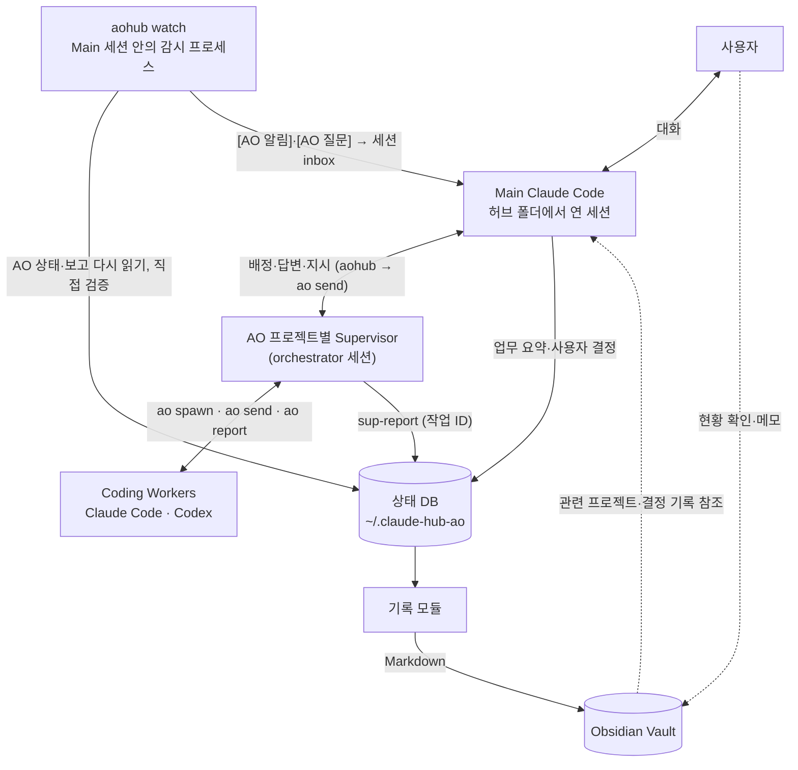

# agent-hub-ao

사용자는 Main Claude Code 세션 하나와만 대화합니다. Main 은 프로젝트별 [Agent Orchestrator](https://github.com/OrchestratorInc/agent-orchestrator)(AO) Supervisor 에 일을 맡기고, Supervisor 는 Claude Code 나 Codex Worker 에게 구현을 시킵니다. 결과와 Worker 질문은 Main 이 입력을 기다리는 동안에도 Main 대화창에 들어오고, 작업·결정·검증 근거는 Obsidian Vault 에 남습니다.

[holiday0726/claude-hub-plugin](https://github.com/holiday0726/claude-hub-plugin)(agent-hub)의 허브 운영 규칙, 배정·보고 형식, 작업 ID, 결정 기록, 대시보드를 그대로 쓰고 AO 연동과 Obsidian 기록을 더했습니다. AO 자체를 다시 만들거나 Main 을 다른 앱으로 바꾸지 않고, Claude Code 플러그인이 AO CLI 를 부릅니다.



## 역할

| 쪽 | 맡는 것 | 하지 않는 것 |
|---|---|---|
| Main | 업무 목표, 완료 조건, 사용자 질문과 결정, 종합 보고, 완료 판정 | Worker 직접 실행, 노트만 보고 실행 상태 판단 |
| AO | Supervisor·Worker 세션의 실행 상태와 수명 주기, Worker 보고 전달 | 사용자 결정 |
| Supervisor | Worker 배정·재지시, 기준이 있는 오류 처리, 판단이 필요하면 Main 에 질문 | 사용자 대신 결정, Vault·작업일지 기록 |
| aohub | 작업 ID, 이벤트·전달 기록, 중복 방지, Main 알림, 노트 갱신(한 곳에서) | AO 를 우회한 세션 제어 |

AO 로 맡긴 작업은 AO 로만 띄우고 멈춥니다. 같은 작업을 `claude --bg` 세션으로 겹쳐 맡기지 않습니다.

## 무엇이 들어 있나

| 구성 | 위치 | 하는 일 |
|---|---|---|
| AO 연동 | `aohub/`, `scripts/aohub.py` | 배정, 질문·답변, 후속 지시, 직접 검증, 감시, 재시작 복구 명령. Python 표준 라이브러리만 씁니다 |
| AO 스킬 | `skills/ao/` | Main 운영 규칙: 세션을 열 때, 배정, 알림·질문 처리, 오류 처리, 하루 정리 |
| 감시 훅 | `hooks/ao_watch_start.py` | 허브 폴더에서 세션을 열면 `aohub watch` 를 그 세션에 붙여 띄웁니다 |
| 허브 규칙 틀 | `templates/hub/` | 허브 역할(`CLAUDE.md`), 세션 사이 약속과 보고 형식(`COORDINATION.md`), 현황판(`STATUS.md`)과 데이터 파일 |
| 대시보드 | `dashboard/` | 세션, 사용자 결정, 현황, 세션 사이 메시지를 보여 주는 읽기 전용 웹 화면 |
| 허브 훅 | `hooks/` | 대시보드 열기, 다른 세션의 허브 폴더 쓰기 막기, git 커밋 문구 검사 |
| 스킬 | `skills/` | `setup`(설치 마무리), `ao`, `humanizer`, `git-message` |
| 문서 | `docs/ao-bridge.md` | 연동 설계, 설치, 명령, 전달·중복 방지, 완료 판정, 재시작·오류 처리, 제약 |

## 빠른 시작

필요한 것

- Claude Code 2.1.234 이상(native Windows 세션 inbox 기준. 개발과 시험은 2.1.318)
- Python 3.8 이상
- [Agent Orchestrator](https://orchestrator.inc/download/) 데스크톱 앱(데몬과 `ao` CLI 가 들어 있습니다. 시험은 0.14.8)
- 쓰고 싶은 Worker CLI(Claude Code, Codex 등)와 그 로그인

### 1. 플러그인 설치

```sh
claude plugin install agent-hub-ao --marketplace smdeveloper7/agent-hub-ao
```

저장소를 받아 고쳐 쓰려면 받은 폴더를 마켓플레이스로 붙입니다. 플러그인은 그 폴더를 그대로 읽으니 설치 뒤 옮기지 않습니다.

```powershell
git clone https://github.com/smdeveloper7/agent-hub-ao.git C:\Users\<나>\agent-hub-ao
claude plugin marketplace add C:/Users/<나>/agent-hub-ao
claude plugin install agent-hub-ao@agent-hub-ao `
  --config python=C:/Users/<나>/AppData/Local/Programs/Python/Python313/python.exe `
  --config hub_dir=C:/Users/<나>/hub
```

설정값을 비워 설치했다면 아무 폴더에서 `claude` 를 열고 `/agent-hub-ao:setup` 을 부릅니다. Python 을 찾고, 허브 폴더를 만들고, 플러그인 설정값을 채웁니다.

### 2. AO 준비

AO 앱을 열거나 앱 없이 `ao daemon` 을 띄웁니다. Windows 설치본의 CLI 는 `%LOCALAPPDATA%\Programs\agent-orchestrator\resources\daemon\ao.exe` 이고, PATH 에 없어도 aohub 가 찾습니다.

맡길 저장소를 AO 프로젝트로 등록합니다.

```sh
ao project add --path <저장소> --id <프로젝트 id> --orchestrator-agent claude-code --worker-agent codex
ao project set-config <프로젝트 id> --permission auto --orchestrator-agent claude-code --worker-agent codex --default-branch main
```

- `set-config` 는 설정을 통째로 바꿉니다. 플래그로 쓸 때는 필요한 값을 한 번에 다 줍니다.
- 원격이 없는 저장소는 `--default-branch` 를 꼭 줍니다. 없으면 Supervisor 가 `idle` 로 보여도 시작하지 못합니다.
- ChatGPT 계정 Codex 가 AO 기본 모델을 거부하면 Worker 모델을 지정합니다(`config.worker.agentConfig.model`). [docs/ao-bridge.md](docs/ao-bridge.md) 참고.

### 3. aohub 설정

```sh
python <플러그인 폴더>/scripts/aohub.py init --vault-dir <Obsidian Vault>
python <플러그인 폴더>/scripts/aohub.py doctor
```

상태와 설정은 플러그인 폴더와 따로 `~/.claude-hub-ao` 에 둡니다(`AOHUB_HOME` 으로 변경). 일일 로그를 기존 기록 스크립트로 남기려면 `--raw-script <스크립트>` 를 줍니다.

### 4. 허브 세션 열기

```sh
cd ~/hub
claude
```

세션이 열리면 훅이 세션 이름을 `hub` 로 붙이고(이미 이름이 있으면 그대로), 감시 프로세스를 이 세션에 붙이고, 대시보드(http://127.0.0.1:4990)를 띄웁니다. 시작 화면에 `AO 감시 시작(Main hub, …)` 이 보이면 이 창이 Main 입니다.

### 5. Manager Agent 로 쓰기(권장)

Main 을 AO 프로젝트의 orchestrator 로 띄우면 AO 앱(과 모바일 앱) 한 곳에서 Main 과 대화하고, Supervisor·Worker 진행도 같이 봅니다.
알림은 공식 경로인 `ao send` 로 들어가고, 감시 프로세스는 Main 세션과 따로 돕니다.

```sh
python ~/.claude-hub-ao/bin/aohub.py setup-manager --path ~/hub --name "Manager Agent"
```

허브 폴더를 git 저장소로 만들고, AO 프로젝트 `hub`(이름 Manager Agent)로 등록하고, Manager 규칙을 넣고, Manager 세션과 감시 프로세스를 띄웁니다. 다시 실행해도 결과가 같습니다.
이후에는 AO 앱에서 **Manager Agent** 세션을 열어 말합니다. 대화가 길어지면 Manager 에게 "대화 비워줘" 라고 합니다. Manager 가 이 대화의 요약을 Obsidian `세션` 폴더에 인계 노트로 남기고 자기 세션을 닫으면, 새 Manager 가 그 노트와 DB 상태로 이어 갑니다(허브 창은 `session-note` 뒤 `/clear`). 허브 폴더에서 연 `claude` 창은 비상용으로 남습니다(그 창을 열면 그 창이 Main 을 이어받습니다).

## 쓰는 법

새 화면은 없습니다. Main 대화창(AO 앱의 Manager Agent, 또는 허브 폴더의 `claude` 창)이 쓰는 곳입니다.

```
나: ao-demo-a 에 multiply 함수 추가 맡겨줘. 시험 통과가 완료 조건이야.
Main: T-20261104-01 로 Supervisor ao-demo-a-4 에 배정했습니다(도착 확인).
      … (입력하지 않아도 결과가 들어옵니다)
Main: [AO 알림] T-20261104-01 완료 검증 통과. Worker 작업 공간에서 시험을 직접 돌려 4개 통과, 커밋 aa0d8c7.
Main: [AO 질문] Q-20261104-01 divide 에서 0 으로 나누면 어떻게 할까요? (ValueError / 기본 오류 / None)
나: ValueError 로
Main: Supervisor 에 전달했고 도착을 확인했습니다. 결정과 이유를 기록했습니다.
```

| 화면 | 용도 |
|---|---|
| Main 대화창(AO 앱 Manager Agent 또는 허브 `claude` 창) | 맡기기, 결과·질문 받기, 답하기, "AO 작업 상태 알려줘", "오늘 작업 정리해줘" |
| Obsidian | `wiki/AO 현황.base`(프로젝트 현황, 판단 대기, 완료 작업, 결정 기록), 작업·결정·프로젝트 노트. 메모를 더해도 보존됩니다 |
| AO 데스크톱 앱 | Manager Agent 와 대화(Manager 모드), Supervisor·Worker 진행 보기, 권한 승인. Supervisor 에게 직접 지시하면 Main 기록에서 빠지니 지시는 Manager 에게 합니다 |
| 허브 대시보드 | 허브 팀 세션 현황. AO 가 띄운 세션과 이 PC 의 다른 세션은 접힌 묶음으로 둡니다(AO 작업은 AO 앱과 Obsidian 에서 봅니다) |

Main 이 쓰는 명령은 `/agent-hub-ao:ao` 스킬에 있고, 사용자가 직접 칠 일은 없습니다. 자주 쓰는 것:

| 명령 | 하는 일 |
|---|---|
| `aohub assign --project --title --request --done --verify [--worker-agent]` | 작업 ID 발급, 프로젝트당 Supervisor 하나 유지, 배정 도착 확인 |
| `aohub status [작업]` | 기록과 AO 에 방금 다시 물은 세션 상태 |
| `aohub questions` / `answer <Q> --text --reason` | 판단 대기 목록, 사용자 답 전달과 결정 기록 |
| `aohub tell <작업> --text` | 같은 작업의 Supervisor 에 후속 지시 |
| `aohub accept <작업> --note` | 검증 명령 없는 작업을 사용자 확인으로 완료 |
| `aohub resume` | Main 재시작 뒤 진행 중 작업, 미처리 질문·알림, 읽을 노트 |
| `aohub daily` | 오늘 AO 작업 정리와 `wiki/log.md` 한 줄 |

전체 명령과 옵션은 [docs/ao-bridge.md](docs/ao-bridge.md) 에 있습니다.

## 완료와 오류

완료는 Main 이 판정합니다. 전송 성공, 세션 idle, 프로세스 종료, Worker·Supervisor 의 done 보고는 완료가 아닙니다. 보고 원문은 노트에 "보고만 받은 것" 으로 따로 둡니다.

| 일의 종류 | 맡길 때 말할 것 | 완료 판정 |
|---|---|---|
| 실행해 확인할 수 있는 일(코드, 빌드) | "시험 통과하고 커밋까지" 처럼 명령과 기대 결과 | 감시 프로세스가 Worker 작업 공간에서 검증 명령을 직접 돌려 통과하고 커밋이 있으면 `완료(검증됨)` |
| 명령으로 확인할 수 없는 일(문서, 조사, 분석) | "docs/design.md 초안" 처럼 볼 결과물 | `확인 필요` 로 Main 에 알림 → 사용자가 결과물을 보고 확인하면 Main 이 `aohub accept` |

오류는 기준이 있으면 Supervisor, 판단이 필요하면 Main(사용자)이 맡습니다.

| 오류 | 처리 |
|---|---|
| Worker 실행 실패, 모델 미지원, 시험·검증 실패 | Supervisor 가 `aohub worker-state` 로 직접 잡아 `error_policy` 기준대로 다시 띄우거나 다시 지시합니다(재시도 횟수, 대체 모델) |
| 재시도 소진, 기준에 없는 오류, 권한 승인, AO 설정 변경, 범위 변경 | Supervisor 가 `blocked`·`question` 으로 Main 에 올리고, Main 이 사용자에게 묻습니다 |
| Supervisor 무응답 | Main 감시가 안전망으로 유예 뒤 Supervisor 에 알리고, 그래도 처리 보고가 없으면 Main 에 알립니다 |

`[답변]` 은 업무 결정일 뿐 도구 권한 승인이 아닙니다. 노트의 상태나 체크박스를 바꿔도 작업이 재개되거나 승인되지 않습니다.

## Obsidian 기록

기록 모듈 하나(`aohub/vault.py`)가 상태 DB 를 다시 그려 노트를 만들어서, 같은 이벤트를 다시 받아도 기록이 늘지 않습니다. Worker 와 Supervisor 는 노트를 쓰지 않습니다.

| 노트 | 내용 |
|---|---|
| `raw/YYYY-MM-DD.md` | 완료 검증, 질문, 결정을 한 건씩. 작업 노트 링크 포함 |
| `wiki/tasks/<작업 ID>.md` | Properties(프로젝트, Supervisor·Worker 세션, 상태, 확인 시각, 완료 조건, 결과물, 커밋, 검증 여부), 검증 근거, 보고만 받은 것, 진행 기록 |
| `wiki/decisions/<질문 ID>.md` | 질문, 선택지, 질문 경로, 답, 이유, 전달 확인 |
| `wiki/projects/<프로젝트>.md` | AO 작업 표, 판단 대기, 최근 결정 |
| `wiki/AO 현황.base` | Obsidian Bases 보기 |

자동으로 고치는 곳은 맡은 Properties 키와 `<!-- aohub:begin … -->` 구역뿐입니다. 그 밖의 본문과 사용자가 더한 Properties 는 그대로 둡니다.

위키(`wiki/`)는 모든 세션이 읽지만 쓰는 것은 허브 Main 만 합니다. `vault_main_only.py` 훅이 Main 이 아닌 세션의 Edit/Write 를 막고, `aohub whoami` 로 지금 세션이 Main 인지 확인합니다. 일지(raw) 한 줄 쓰기는 공통 스크립트로 모든 세션이 계속 씁니다.

## 시험

```sh
python tests/test_aohub.py            # AO 연동 Mock 시험(가짜 AO, 임시 Vault)
python tests/test_setup_hub.py        # 설치 스크립트
python tests/test_open_dashboard.py   # 대시보드 훅
python tests/test_style_basic.py      # git 문구 규칙
python tests/test_style_multi.py
python dashboard/test_server.py
claude plugin validate --strict .
```

Windows 에서 실제 AO 0.14.8 과 Claude Code 2.1.318 로 확인한 것은 다음과 같습니다. 명령과 결과는 [docs/ao-bridge.md](docs/ao-bridge.md) 에 있습니다.

| 시나리오 | 결과 |
|---|---|
| 배정 → Supervisor → Worker → 결과 → Main 보고 | Claude Code·Codex Worker 모두 확인, Main 이 작업 공간에서 시험 재실행 |
| 질문 → Main → 사용자 답 → 전달 → 재개 | Supervisor transcript 에서 답 도착 확인, 결정 노트·일일 로그 기록 |
| 입력 대기 중인 Main 의 자동 수신 | 알림이 새 turn 으로 시작됨(허브 창 inbox, Manager Agent 의 ao send 모두) |
| Manager Agent 모드 | AO 로 받은 요청을 Manager 가 배정하고, 완료 알림을 ao send 로 받아 직접 확인 뒤 보고 |
| 두 프로젝트 동시 배정 | 세션·커밋·기록이 섞이지 않음 |
| 전송 불확실·재수신 | 재전송 전 AO 전달 기록과 transcript 확인, 같은 작업·Worker·기록이 다시 생기지 않음 |
| Main·감시 프로세스 재시작 | 새 Main 이 `resume` 으로 진행 중 작업, 열린 질문, 이전 결정 이유를 찾음 |
| Supervisor 의 Worker 오류 처리 | 모델 미지원으로 실패한 Codex Worker 를 Supervisor 가 대체 모델로 다시 띄움 |

`tests/test_hub_only_write.py` 는 원본 저장소에서도 실패하는 상태로 가져왔습니다.

## 알려진 제약

- inbox 메시지 형식(auth 줄 다음 user 줄)은 공식 문서에 auth 줄만 있고, 메시지 줄은 Claude Code 2.1.318 에서 확인했습니다. Claude Code 판이 바뀌면 다시 확인합니다.
- inbox 쓰기 성공은 전달 통로에 들어갔다는 뜻입니다. Main 이 처리했는지는 `aohub ack` 로 기록합니다.
- 감시는 5초 주기 조회입니다. AO SSE 이벤트는 쓰지 않습니다.
- Supervisor 규칙(`orchestratorRules`)은 Supervisor 를 띄울 때만 들어갑니다. 바꾼 규칙은 다음 Supervisor 부터, 배정 메시지 안의 기준은 바로 적용됩니다.
- Supervisor 와 Worker 도 사용자 전역 `~/.claude/CLAUDE.md` 를 읽습니다. 전역 규칙과 연동 규칙이 부딪히면 연동 규칙에 금지 문구를 더합니다.

## 허브 기본 기능

원본 agent-hub 의 기능은 그대로 있습니다. AO 를 쓰지 않는 일은 예전처럼 `claude --bg` 세션에 배정하고 대시보드로 봅니다.

<picture>
  <source media="(prefers-color-scheme: dark)" srcset="docs/images/dashboard-dark.png">
  
</picture>

| 훅 | 언제 | 하는 일 |
|---|---|---|
| `open_dashboard.py` | 세션 시작 | 허브 폴더에서 열리면 대시보드를 띄우고, `orca` 가 켜져 있으면 Orca 탭으로 엽니다 |
| `ao_watch_start.py` | 세션 시작 | 허브 폴더에서 열리면 세션 이름을 `hub` 로 붙이고, aohub 가 설정되어 있으면 감시 프로세스를 그 세션에 붙입니다 |
| `hub_only_write.py` | Edit, Write 직전 | 허브 폴더 밖 세션이 허브 폴더 파일을 고치지 못하게 막습니다 |
| `vault_main_only.py` | Edit, Write 직전 | Obsidian 위키(`wiki/`)는 허브 Main 세션만 고칩니다. 보기와 일지(raw) 쓰기는 막지 않습니다 |
| `git-message-style.py` | Bash, PowerShell 직전 | git 커밋·PR 문구가 개조식 규칙을 어기면 막습니다(`CLAUDE_GIT_STYLE=off` 로 잠시 끔) |

| 설정값 | 필수 | 뜻 | 기본값 |
|---|---|---|---|
| `python` | 예 | 훅을 돌릴 Python. Windows 는 `python.exe` 절대 경로 | 없음 |
| `hub_dir` | 예 | 허브 폴더 절대 경로 | 없음 |
| `dashboard_port` | 아니오 | 대시보드 포트 | `4990` |
| `orca` | 아니오 | Orca 탭으로 대시보드 열기 | 켬 |
| `ao_watch` | 아니오 | 허브 세션에 AO 감시 프로세스 붙이기 | 켬 |
| `hub_title` | 아니오 | 허브 세션에 자동으로 붙일 이름(`/rename` 과 같음). 비우면 붙이지 않음 | `hub` |

허브 폴더 구성, 대시보드 화면, 설정 예시는 [templates/hub/CLAUDE.md](templates/hub/CLAUDE.md), [dashboard/README.md](dashboard/README.md), [examples/](examples/) 에 있습니다. 허브 규칙의 감독 스킬은 [Addy-skills](https://github.com/holiday0726/Addy-skills) 플러그인을 함께 설치해 씁니다(`/agent-hub-ao:setup` 이 설치).

## 저장소 구조

```
.claude-plugin/   plugin.json, marketplace.json
aohub/            AO 연동(config, store, ao, inbox, vault, bridge, cli)
dashboard/        server.py, index.html, test_server.py, vendor/
docs/             ao-bridge.md, README 그림(images/)과 원본(diagrams/)
examples/         hub.settings.json, supervisor.settings.json, user.settings.json
hooks/            hooks.json, open_dashboard.py, ao_watch_start.py, hub_only_write.py, git-message-style.py, hubpath.py
scripts/          aohub.py, setup_hub.py
skills/           ao/, setup/, humanizer/, git-message/
templates/hub/    CLAUDE.md, COORDINATION.md, STATUS.md, agents.json, decisions.json, dev-occupancy.json
tests/            test_aohub.py 와 허브 훅·설치 스크립트 시험
```

## 라이선스와 출처

MIT 라이선스입니다([LICENSE](LICENSE)).

- 허브 규칙 틀, 대시보드, 허브 훅, setup·git-message 스킬: [holiday0726/claude-hub-plugin](https://github.com/holiday0726/claude-hub-plugin), MIT
- `skills/humanizer`: [blader/humanizer](https://github.com/blader/humanizer), MIT
- `dashboard/vendor/xterm.js`, `xterm.css`: [xterm.js](https://github.com/xtermjs/xterm.js) 5.5.0, MIT
- `dashboard/vendor/WantedSansVariable.woff2`: [Wanted Sans](https://github.com/wanteddev/wanted-sans) 1.0.3, SIL OFL 1.1
- 연동 대상: [Agent Orchestrator](https://github.com/OrchestratorInc/agent-orchestrator), Apache-2.0(코드를 포함하지 않고 CLI 만 부릅니다)
